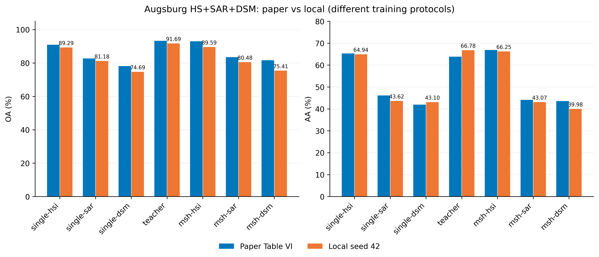
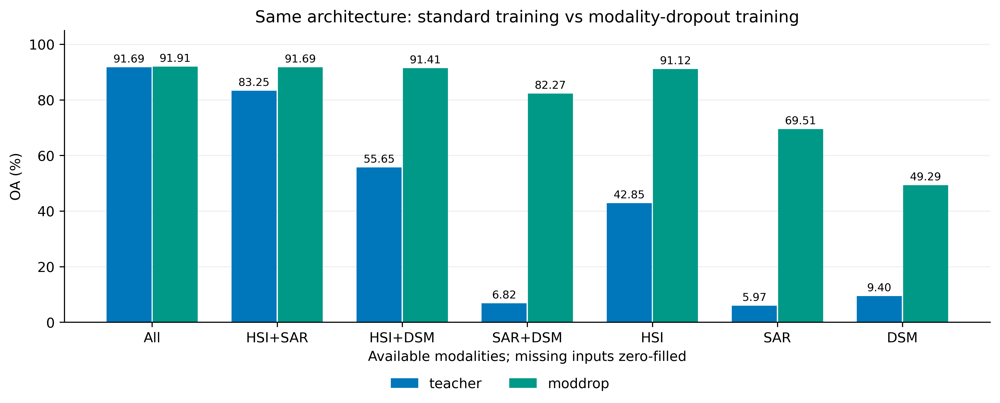
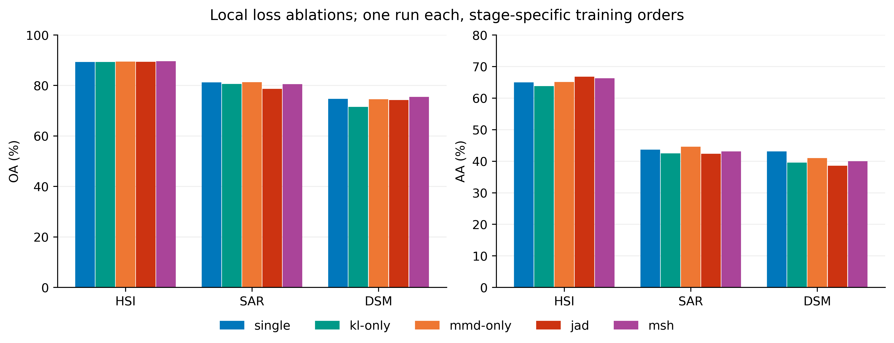
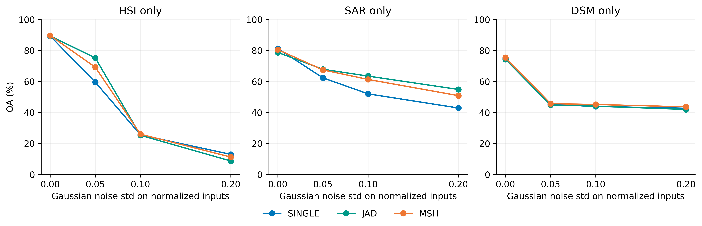

# Augsburg 全实验数据分析与 MSH-Net 论文对照

## 一、结论与证据范围

**本地完成了Augsburg三模态核心、蒸馏消融、随机模态丢弃和噪声实验。完整教师OA达91.69%，随机模态丢弃在SAR+DSM条件下达82.27%，SAR学生在标准差0.10的噪声下较单模态基线提高11.45个百分点。** 完整融合的互补价值、普通完整模型的缺失敏感性及面向缺失训练的有效性均获得实验支持。以下保留各模态、各类别指标与论文表VI的逐项比较，并结合训练协议解释差异。

核查时，在项目 outputs 中找到的非 quick 正式结果为 **Augsburg HSI+SAR+DSM、seed 42，82 个测试条件、18 个训练阶段**。每个条件均测试 77533 个官方测试点。没有在当前目录找到另外三个模态组合、seed 43/44 的正式结果；verification 和 quick 目录仅是此前流程检查，不能计入正式实验，更不能冒充多次重复。本文不以“用户执行过某条命令”替代对产物的核实。

82 条记录不是 82 次独立训练：核心含 30 个测试条件，扩展再加 ModDrop 7 条、KL/MMD 消融 6 条、固定 η 干预 3 条、噪声条件 36 条。实际训练阶段是 18 个，固定 η 和概率平均没有独立训练。因此现有数据只有一个训练 seed，没有可报告的跨 seed 标准差。汇总 CSV 中 n_seeds=1、std 为空，与此相符。

论文：Wei 等，MSH-Net: Modality-Shared Hallucination With Joint Adaptation Distillation for Remote Sensing Image Classification Using Missing Modalities，IEEE TGRS 61 (2023)，DOI 10.1109/TGRS.2023.3265650。主对照为 **表 VI（本地 PDF 第11页）**；类别/样本数来自表 II（第6页）；参数与增强来自 IV-B/IV-C；论文蒸馏消融表 VII 在 Houston HSI+LiDAR 上，不能当成当前 Augsburg 消融的数值目标。

## 二、数据审核与实验是否有效

1. 从全部 82 份 predictions.csv 重新计算 OA、AA、Kappa、混淆矩阵，与 results.json 精确一致（数值比较容差 1e-12）。每份预测都覆盖索引 0～77532，真实标签和测试顺序一致，没有以小样本 demo 冒充官方测试。
2. 核对 18 个 history.json 和 best.pt：教师、单模态、JAD、KL-only、MMD-only、ModDrop 各训练500 epoch；三个 MSH 融合阶段各100 epoch。每个 epoch 均遍历608个训练点；最佳模型 epoch 与验证选择规则一致。
3. 官方原训练集761点，本地分为608训练、153验证；测试77533点。随机点划分的标签中心不重复，但7×7邻域存在重叠，后文量化说明。
4. 原始类别总数与论文表 II 逐类一致；正式预测中的真实标签，与原始TestImage按MATLAB列序提取的官方测试标签逐样本一致。归一化、patch 顺序等已在先前 data-check 中核对；本报告额外独立核对正式预测和标签。指标正确不等于模型已经复现论文。
5. 原始训练文件、模型检查点和正式结果保持不变。核查清单、SHA256、复算记录在 audit.json；本脚本只生成分析文件，不训练模型。

**指标解释**：OA=全部正确像素/全部测试像素；AA=七类召回率的等权平均，不是 precision，也不是 F1；Kappa 校正随机一致性。文中 OA/AA 为百分数，差值统一用百分点（pp）。论文 Ka 栏以0～100显示，本地 Kappa 以0～1存储，比较前已除以100，避免把量纲差误认为算法差距。

## 三、与论文表 VI 的直接数值对照

差值为“本地−论文”；teacher-only-X 指完整模态训练教师仅在测试保留X，缺失输入用零填充。

| 条件/模型 | 论文OA | 本地OA | 差值pp | 论文AA | 本地AA | 差值pp |
| --- | --- | --- | --- | --- | --- | --- |
| single-hsi | 90.91 | 89.29 | -1.62 | 65.32 | 64.94 | -0.38 |
| single-sar | 82.68 | 81.18 | -1.50 | 46.12 | 43.62 | -2.50 |
| single-dsm | 78.12 | 74.69 | -3.43 | 41.96 | 43.10 | +1.14 |
| teacher | 93.31 | 91.69 | -1.62 | 63.85 | 66.78 | +2.93 |
| msh-hsi | 92.99 | 89.59 | -3.40 | 66.86 | 66.25 | -0.61 |
| msh-sar | 83.51 | 80.48 | -3.03 | 44.11 | 43.07 | -1.04 |
| msh-dsm | 81.61 | 75.41 | -6.20 | 43.60 | 39.98 | -3.62 |
| teacher-only-hsi | 72.03 | 42.85 | -29.18 | 40.32 | 25.68 | -14.64 |
| teacher-only-sar | 3.30 | 5.97 | +2.67 | 17.92 | 21.97 | +4.05 |
| teacher-only-dsm | 1.98 | 9.40 | +7.42 | 14.28 | 20.47 | +6.19 |

### 3.1 数值复现判定

- 三个单模态 OA 均低于论文：HSI低1.62点，SAR低1.50点，DSM低3.43点，说明差距在蒸馏之前就已存在。
- 完整模态教师 OA=91.69%，低于论文93.31%共1.62点；但 AA=66.78%，高于论文63.85%共2.93点。不能说本地模型所有维度都更差，也不能凭更高 AA 声称全面更好。
- 最终 MSH 的 HSI/SAR/DSM OA 分别为89.59%、80.48%、75.41%，论文为92.99%、83.51%、81.61%；差距分别 **−3.40、−3.03、−6.20点**。这些不是表格保留两位小数能解释的舍入误差。
- HSI MSH 的 AA 与论文相差−0.61点，SAR−1.04点，DSM−3.62点。这些指标为比较模型的类别平均表现提供了依据，解释时同时考虑训练与选择协议。
- 缺失教师尤其是仅HSI的结果与论文差别很大：42.85%对72.03%。这进一步说明训练所得模型依赖/选择与原实验并不相同。

| 模型 | 论文Kappa | 本地Kappa | 差值 |
| --- | --- | --- | --- |
| single-hsi | 0.8689 | 0.8458 | -0.0231 |
| single-sar | 0.7475 | 0.7234 | -0.0241 |
| single-dsm | 0.6764 | 0.6278 | -0.0486 |
| teacher | 0.9025 | 0.8802 | -0.0223 |
| msh-hsi | 0.8985 | 0.8506 | -0.0479 |
| msh-sar | 0.7557 | 0.7127 | -0.0430 |
| msh-dsm | 0.7250 | 0.6344 | -0.0906 |

### 3.2 把“基线就更弱”与“方法增益不足”分开

| 保留模态 | 论文MSH−单模态OA | 本地MSH−单模态OA | 论文AA增益 | 本地AA增益 |
| --- | --- | --- | --- | --- |
| HSI | +2.08 | +0.30 | +1.54 | +1.31 |
| SAR | +0.83 | -0.70 | -2.01 | -0.55 |
| DSM | +3.49 | +0.72 | +1.64 | -3.12 |

论文中 MSH 相对单模态的 OA 增益，HSI/SAR/DSM 为+2.08/+0.83/+3.49点；本地仅+0.30/−0.70/+0.72点。因而差距并非全由基线偏低造成：在基线之上，MSH 本身的增益也少了约1.78/1.53/2.77点。

SAR 的趋势直接不同：论文 OA 上升，本地下降。DSM 虽然 OA 都上升，但论文 AA 上升1.64点，本地下降3.12点。HSI 的改善方向一致、幅度明显不足。

需要纠正一个常见过度解读：论文表 VI 的 SAR AA 本身就是44.11%，低于 SAR单模态的46.12%；所以“论文显示所有模态所有指标都提高”也不成立。当前本地SAR的AA下降方向与表VI相同，但OA下降与其相反。

### 3.3 论文正文与表格不一致如何处理

论文三模态讨论正文把 DSM/SAR 的 MSH OA 写为81.86%/83.35%，而表VI是81.61%/83.51%；正文部分“相对基线增益”也不完全等于表格相减。本文统一使用经视觉核对的**表VI**，并用其原数值重新计算增益，没有把正文、表格混用。这里是在处理来源内部差异，不意味着可以自行修改本地测试结果去匹配任一版本。

## 四、完整模态融合与缺失模态：哪些趋势符合论文

| 保留模态 | 拼接OA | 概率平均OA | 教师OA/AA | ModDrop OA/AA | ModDrop−教师OA |
| --- | --- | --- | --- | --- | --- |
| hsi+sar+dsm | 91.54 | 88.85 | 91.69/66.78 | 91.91/65.64 | +0.22 |
| hsi+sar | 64.79 | 87.38 | 83.25/52.63 | 91.69/63.99 | +8.44 |
| hsi+dsm | 83.62 | 87.71 | 55.65/45.18 | 91.41/65.49 | +35.76 |
| sar+dsm | 2.87 | 83.97 | 6.82/18.48 | 82.27/47.49 | +75.45 |
| hsi | 40.42 | 34.32 | 42.85/25.68 | 91.12/63.61 | +48.27 |
| sar | 2.37 | 68.94 | 5.97/21.97 | 69.51/31.98 | +63.54 |
| dsm | 2.76 | 36.65 | 9.40/20.47 | 49.29/28.23 | +39.89 |

表中 OA/AA 单位均为%。输入拼接和概率平均是课程对照，不是论文表VI列出的独立算法。

### 4.1 完整输入时融合有价值

教师完整模态OA比HSI单模态高2.41点，与论文“融合有收益”方向一致。简单拼接已经达到91.54%，教师为91.69%，只差0.15点；拼接的AA=68.20%甚至高于教师66.78%。因此现有数据不支持复杂特征融合明显优于简单拼接。

概率平均OA=88.85%，低于HSI单独89.29%。这个结果表明等权加入较弱分支可能稀释强分支；它不是“多传感器融合必然有效”的证据。

### 4.2 直接缺失会使普通教师崩溃

教师只有HSI/SAR/DSM时，OA降为42.85%/5.97%/9.40%；专门训练的MSH是89.59%/80.48%/75.41%。避免缺失崩溃的方向与论文一致。

但单模态基线本来就有89.29%/81.18%/74.69%。所以“MSH远好于零填充教师”主要验证了缺失适配训练的重要性，不能独自证明JAD蒸馏比普通单模态训练更优。

late-mean仅HSI时OA34.32%、AA14.29%、Kappa=0，是因为缺失分支仍读零输入且全部等权参与，并非仅运行HSI分类器。其预测退化为单一类别。这种基线不能代表“屏蔽不可用分支后只平均可用分支”的方案。

### 4.3 ModDrop 是本次有明确价值的工程对照

在训练时以50%概率为每个样本随机丢一个完整模态，其余样本完整输入；结构与教师相同。它把缺失SAR的 HSI+DSM 情况从55.65%提升至91.41%，缺失HSI的 SAR+DSM 从6.82%提升至82.27%。这说明训练时覆盖缺失条件能显著缓解分布偏移。

ModDrop仅HSI时OA91.12%，超过MSH89.59%，但AA63.61%低于MSH66.25%。它不是所有指标都更好。仅SAR/DSM时，ModDrop仍低于各自单模态/MSH。原因之一的候选解释是：训练只随机缺一个，而仅保留一个意味着缺两个，训练并未直接覆盖这种掩码分布；还需要后续实验验证这一解释。

ModDrop完整输入OA91.91%略高于教师91.69%，AA却降低1.13点。不能只挑OA宣称全面优越。该扩展是课程改动/基线，不是论文表VI的方法，论文没有这组三模态ModDrop数值供逐项匹配。

## 五、蒸馏消融：联合MMD与KL是否一定优于单项

| 保留模态 | 仅CE OA/AA | CE+KL OA/AA | CE+MMD OA/AA | JAD OA/AA | MSH OA/AA |
| --- | --- | --- | --- | --- | --- |
| HSI | 89.29/64.94 | 89.30/63.79 | 89.41/65.09 | 89.38/66.75 | 89.59/66.25 |
| SAR | 81.18/43.62 | 80.56/42.47 | 81.25/44.56 | 78.67/42.31 | 80.48/43.07 |
| DSM | 74.69/43.10 | 71.52/39.56 | 74.49/40.97 | 74.24/38.56 | 75.41/39.98 |

### 5.1 HSI：AA有收益，联合项并非OA最优

JAD的AA66.75%高于KL-only63.79%、MMD-only65.09%和CE64.94%；这支持联合损失在本次HSI上改善平均类别表现。OA方面，MMD-only89.41%略高于JAD89.38%，差约0.03点，不能把它写成JAD所有指标最优。最终MSH的OA89.59%更高，但AA回落至66.25%。

### 5.2 SAR：联合损失在干净输入下表现最差

MMD-only得到81.25% OA、44.56% AA，略优于CE基线81.18%/43.62%；KL-only为80.56%/42.47%；JAD降到78.67%/42.31%。这组数据提示同时引入MMD和KL没有形成预期协同，输出蒸馏可能参与了干净精度的负迁移。不能仅凭该表证明“KL就是唯一原因”：教师质量、优化和训练顺序等因素也会影响结果。

### 5.3 DSM：当前蒸馏组合没有解决类别平均表现

CE为74.69%/43.10%；KL-only下降至71.52%/39.56%；MMD-only74.49%/40.97%；JAD74.24%/38.56%。最终MSH使OA达到75.41%，但AA39.98%仍低于基线。对DSM，当前主要问题不是缺少一次融合，而是学生对部分类别的学习发生退化。

### 5.4 这些消融与论文表VII能否直接比较

不能。论文表VII是Houston HSI+LiDAR上的FD/LD/ADD/DHAD/JAD比较，评价对象是相应MSH流程；本地kl-only/mmd-only是Augsburg三模态教师指导的单学生，没有再为它们分别训练最终融合。因此不是同一数据、同一对象、同一对照。

本地各阶段通过实验名散列设置训练随机顺序，kl-only、mmd-only、jad未严格使用相同批次顺序；又只有一个训练seed。以上是观察到的趋势，不能作为单因素损失项因果效应的最终定论。更严谨的消融应预先固定相同初始化和批次顺序，并重复多次。

## 六、噪声鲁棒性：干净精度与稳定性不是一回事

噪声加在归一化后的可用输入上：独立高斯噪声标准差σ=0/.05/.1/.2，然后截断到[0,1]。它是输入扰动，不是模态完全缺失；σ=.2不能未经传感器标定就解释成真实仪器的20%噪声。相同输入使用固定噪声实现，但只测试了一种噪声随机实现，没有噪声重复的标准差。

| 保留模态 | 模型 | σ=0 OA/AA | σ=.05 OA/AA | σ=.10 OA/AA | σ=.20 OA/AA |
| --- | --- | --- | --- | --- | --- |
| HSI | single | 89.29/64.94 | 59.46/44.35 | 25.52/28.30 | 12.89/21.32 |
| HSI | jad | 89.38/66.75 | 75.10/52.76 | 25.21/27.73 | 8.63/17.68 |
| HSI | msh | 89.59/66.25 | 69.14/49.50 | 25.93/28.35 | 11.18/19.82 |
| SAR | single | 81.18/43.62 | 62.27/24.97 | 51.96/20.57 | 42.83/16.92 |
| SAR | jad | 78.67/42.31 | 67.81/29.42 | 63.41/28.40 | 54.80/25.08 |
| SAR | msh | 80.48/43.07 | 67.41/27.57 | 61.25/24.85 | 50.80/20.25 |
| DSM | single | 74.69/43.10 | 45.16/24.08 | 43.81/22.38 | 42.65/20.76 |
| DSM | jad | 74.24/38.56 | 44.77/22.40 | 44.02/20.50 | 41.90/18.58 |
| DSM | msh | 75.41/39.98 | 45.64/23.02 | 45.08/21.35 | 43.58/19.57 |

- **HSI轻噪声**：σ=.05时JAD75.10%、MSH69.14%，比基线59.46%分别高15.64和9.68点。蒸馏在此条件下有明显的本次收益。但σ=.2时JAD8.63%、MSH11.18%，反而低于基线12.89%；不能说蒸馏普遍抗噪。
- **SAR**：虽然JAD干净输入OA较低，但σ=.10时达到63.41%，高于基线51.96%共11.45点；σ=.20时54.80%对42.83%，提高11.97点。AA也有提升。这是干净准确率与噪声鲁棒性之间存在权衡的有力观测；最终MSH在噪声下介于学生和基线之间，没有超过JAD学生。
- **DSM**：MSH在三档噪声下OA比基线高约0.48、1.28、0.93点，但AA分别低约1.06、1.03、1.19点。不能用这点OA优势忽略少数类表现。
- HSI高噪声下所有模型都明显失效。没有噪声训练时，这反映模型对当前扰动的敏感性。该σ扫描属于本次课程扩展，按本地扰动设置单独评价。

## 七、固定η干预：当前自适应融合权重是否发挥作用

η控制“共享知识学生”和“单模态特有分支”的logits权重，两分支都看同一可用模态；它不是在HSI/SAR/DSM三种传感器之间分配权重。

三个MSH均选择融合epoch=1，其η约0.49999928/0.49999106/0.49997759。逐样本比较固定η=.5和原模型：

| 输入 | 噪声σ | 改为η=.5后改变预测数/77533 |
| --- | --- | --- |
| HSI | 0 | 0 |
| HSI | 0.05 | 0 |
| HSI | 0.1 | 0 |
| HSI | 0.2 | 0 |
| SAR | 0 | 0 |
| SAR | 0.05 | 1 |
| SAR | 0.1 | 0 |
| SAR | 0.2 | 0 |
| DSM | 0 | 0 |
| DSM | 0.05 | 0 |
| DSM | 0.1 | 0 |
| DSM | 0.2 | 0 |

这说明测试部署模型的η与等权几乎没有实质差异。最后epoch的η实际上有所更新（先前核查约0.49971/0.49612/0.49041），只是验证规则选中了最早的模型；不能误判为“η没有梯度”。更合理的判断是：**当前证据没有显示学习η相对近似等权融合带来收益。**

固定η实验复用了学习η时的分类头，只在测试时把η设为.5；不是从头固定η训练的严格对照。也未评估完全不做融合微调的双模型平均，所以不能把MSH优于JAD的全部差异精确归因于哪一组件。

## 八、类别不平衡与空间验证：为何高OA可能误导

类别名称与编号已对照论文表II核实，预测CSV中编码为0～6，对应下表C1～C7。

| 类别 | 原训练/现训练/验证 | 测试数 | HSI recall | MSH-HSI recall | 教师 recall | ModDrop全模态 recall |
| --- | --- | --- | --- | --- | --- | --- |
| C1 森林 | 146/117/29 | 13361 | 97.50 | 97.47 | 97.75 | 97.90 |
| C2 住宅区 | 264/211/53 | 30065 | 97.54 | 97.92 | 98.86 | 98.63 |
| C3 工业区 | 21/17/4 | 3830 | 56.61 | 63.94 | 69.95 | 71.25 |
| C4 低矮植被 | 248/198/50 | 26609 | 88.55 | 87.86 | 92.20 | 93.46 |
| C5 园圃/分配地 | 52/41/11 | 523 | 60.80 | 60.99 | 55.07 | 57.17 |
| C6 商业区 | 7/6/1 | 1638 | 14.41 | 11.11 | 2.44 | 10.50 |
| C7 水体 | 23/18/5 | 1507 | 39.15 | 44.46 | 51.16 | 30.59 |

森林、住宅区、低矮植被三个大类共占测试点90.33%，OA主要由它们决定。商业区在原官方训练集就只有7点，本地进一步拆分为6训练+1验证，测试却有1638点。教师对商业区的召回率仅2.44%，MSH-HSI11.11%，低于HSI基线14.41%。教师高总体准确率不代表它对小类提供了可靠监督。

MSH-DSM在住宅区召回率上升约3.92点，却在园圃下降约17.59点、工业区下降约6.19点；这解释了为什么OA提高而AA下降。论文原表也存在OA与AA的权衡，但本地DSM退化更明显，不能混为相同结论。

空间验证核查：153个验证中心都在某个训练中心Chebyshev距离3以内，其中148个在距离1以内；7×7 patch全部有训练邻域重叠。标签中心索引不重复，但输入空间上下文不独立。由此，验证OA经常达到99%～100%，并不意味着在空间独立区域也有相同表现。这不是发现官方测试标签进入训练，而是发现当前随机点内部验证较容易。

一个验证点就改变OA约0.65点，商业区仅一个验证点，模型选择对小类和微小差异都不稳定。这与融合选epoch1相容，但没有做替代划分实验，不能断言它是全部差距的唯一原因。

## 九、为什么与论文不一致：事实、差异与假设分开

| 项目 | 论文/作者代码 | 当前本地实现 | 对结论的影响 |
|---|---|---|---|
| 数据集与测试样本 | Augsburg三模态、官方测试77533点 | 同一测试数量与逐类分布 | 对齐；不是用了不同测试规模 |
| 训练数量 | 表II训练761点 | 608训练、153内部验证，未做全量重训 | 明确不同，减少约20.1%训练样本 |
| 网络与蒸馏 | 作者多模态/单模态网络、MMD+KL | 复用作者网络及JDA，做Mac内存等价优化 | 主要结构接近，不等于全部训练协议一致 |
| α/β | HSI为(2,1)，SAR/DSM为(1,5) | 与本组三模态配置一致 | 不能把差距归因于本组α/β抄错 |
| 输入patch | 7×7，边界replicate | 7×7，边界clip等价取邻域 | 主要对齐 |
| 随机翻转 | 正文和作者dataloader含水平/垂直翻转 | 当前正式runner未实现训练翻转 | 明确的实现遗漏/协议差异，不是已证明可忽略的项 |
| 优化 | SGD，lr=.001，momentum=.9，cosine | 同类优化器；5epoch warmup+按epoch cosine | 核心量级一致，调度实现不能视为逐步对齐 |
| 主要训练轮数 | 论文概述500epoch | 教师/单模态/学生等500epoch | 对齐主要阶段；不能笼统说没训练够 |
| 融合轮数 | 作者s2f配置100epoch | 100epoch | 对齐作者配置；正文未单列详细融合轮数 |
| 融合权重 | 论文式(10)单η；作者代码两个自由权重初始1/0 | sigmoid单η，初始.5/.5；特征与BN冻结 | 论文公式与发布代码有差异，本地也不等于发布代码 |
| 模型选择 | 发布脚本每epoch在名为test_loader的官方test分区评估并更新best | 独立内部验证OA/CE选择，官方test最后评估 | 明确不同；不据此推断论文所有数值的唯一来源 |
| 重复次数 | 正文说3次平均，考虑初始化随机性 | 当前证据仅seed42；构造器保留作者固定初始化 | 尚无跨run波动估计；加seed也不自动等于独立随机初始化 |
| 消融与扩展 | Houston消融、其他原文对照 | Augsburg学生损失消融、ModDrop、Gaussian噪声 | 作为课程扩展独立评价，并注明对应任务与条件 |

这些差异中，训练点减少、缺少翻转、融合实现和选择规则等都有明确代码/配置证据；**它们分别解释多少性能差距尚未经过受控实验验证。** 不能把所有差距直接归因于Mac或MPS数值精度，也不能仅凭这次结果判定原论文方法无效。

本地入口是此前为课程实验建立的可运行版本，未完全对齐论文及发布脚本；尤其未实现随机翻转应明确记入实现局限，不能归咎于用户命令。后续若追求原文对齐，应在新输出目录中修订并单独记录协议，保留这批结果作为现有协议的完整对照。

论文正文三模态收益有内部数字不一致、公开代码也保留若干CUDA/配置问题；这进一步要求把论文说明、发布代码、本地改动分别记录，而不是随意选能匹配本地结果的数字。

## 十、哪些结论可以写进作业，哪些不可以

| 命题 | 当前证据判断 |
|---|---|
| 多模态完整输入有助于分类 | 支持：教师比最佳单模态OA高2.41点 |
| 未针对缺失训练的完整输入模型会显著退化 | 支持，与论文方向一致 |
| MSH可避免直接零填充的严重退化 | 支持，但普通单模态基线也能避免 |
| MSH稳定优于所有单模态基线 | 不支持：SAR的OA/AA下降，DSM的AA下降 |
| 联合MMD+KL总是优于单项损失 | 不支持：本地SAR/DSM干净输入结果不符合 |
| JAD在噪声下没有价值 | 不支持：SAR噪声结果及HSI轻噪声有明显收益 |
| 学习η是最终收益的主要来源 | 不支持：固定.5干预几乎不改变预测 |
| ModDrop在所有缺失情况下最优 | 不支持；但多种条件下显著优于普通教师 |
| 已复现论文表VI数值 | 不支持：MSH三种输入OA差3.03～6.20点 |
| 已验证两个数据集、四组组合、三个seed | 当前文件证据不足；不能用quick/verification替代 |
| 90%以上OA代表所有类别都识别良好 | 不支持：商业区等小类召回率很低 |

## 十一、后续实验优先级

1. **先确认其他输出位置和重复实验是否真实完成。** 当前可见正式数据只有一组seed。若其他结果在别处，应合并其独立产物核查，不补造均值/标准差。
2. **若目标是论文数值复现，先修协议而非盲目加epoch。** 补齐一致的同步水平/垂直翻转，清楚规定初始化与重复，核对融合实现。训练761点可采用事先确定训练时长后全量重训的方案，保留独立最终测试；不建议为了贴近论文而反复用官方test挑最优结果。
3. **针对SAR/DSM做严格配对消融。** 固定相同初始化与批次顺序，比较CE、MMD、KL、MMD+KL，并重复多次。只在验证集做参数选择；不要据本报告看过的测试结果反复挑超参数。
4. **改进缺失适配时可把ModDrop作为强基线。** 预先定义覆盖缺一个和缺两个的非空掩码训练，检查是否提高仅SAR/DSM条件；同时报告AA和每类召回率。这是待做的改进，不是本报告已有结果。
5. **更严格空间验证应另立协议。** 目前邻域重叠使内部验证非常容易。空间分组/隔离需检查小类可分性，不能简单把商业区唯一验证点丢掉；改协议后不可与当前随机点验证不加说明混表。

## 十二、可直接使用的实验结论文字

在Augsburg HSI–SAR–DSM三模态实验中，完整模态教师取得91.69% OA，较最佳单模态HSI基线提高2.41个百分点。针对模态缺失训练的MSH模型明显优于直接零填充缺失输入的完整模态教师，但相对对应单模态基线的收益具有模态和类别依赖性：仅HSI与DSM输入时OA分别提高0.30和0.72个百分点，仅SAR时下降0.70个百分点，且DSM的AA下降3.12个百分点。蒸馏消融未显示联合MMD与KL在所有输入下优于单项损失，不过SAR学生在高斯噪声下具有较好的鲁棒性。ModDrop显著缓解多种缺失模式的退化，可作为课程项目的有效工程基线。与原论文表VI相比，本地三种MSH输入设置的OA低3.03至6.20个百分点，对照结果结合训练样本划分、增强、融合和模型选择等差异及单次运行条件进行分析。

## 附录A：全部正式测试条件

| 实验 | 保留输入 | 噪声σ | OA (%) | AA (%) | Kappa |
| --- | --- | --- | --- | --- | --- |
| single-hsi | hsi | 0.0 | 89.29 | 64.94 | 0.8458 |
| single-hsi | hsi | 0.05 | 59.46 | 44.35 | 0.4679 |
| single-hsi | hsi | 0.1 | 25.52 | 28.30 | 0.1475 |
| single-hsi | hsi | 0.2 | 12.89 | 21.32 | 0.0601 |
| single-sar | sar | 0.0 | 81.18 | 43.62 | 0.7234 |
| single-sar | sar | 0.05 | 62.27 | 24.97 | 0.4072 |
| single-sar | sar | 0.1 | 51.96 | 20.57 | 0.2437 |
| single-sar | sar | 0.2 | 42.83 | 16.92 | 0.1047 |
| single-dsm | dsm | 0.0 | 74.69 | 43.10 | 0.6278 |
| single-dsm | dsm | 0.05 | 45.16 | 24.08 | 0.1814 |
| single-dsm | dsm | 0.1 | 43.81 | 22.38 | 0.1609 |
| single-dsm | dsm | 0.2 | 42.65 | 20.76 | 0.1365 |
| early-concat | hsi+sar+dsm | 0.0 | 91.54 | 68.20 | 0.8782 |
| early-concat | hsi | 0.0 | 40.42 | 40.42 | 0.2084 |
| early-concat | sar | 0.0 | 2.37 | 15.49 | 0.0041 |
| early-concat | dsm | 0.0 | 2.76 | 14.96 | 0.0071 |
| early-concat | hsi+sar | 0.0 | 64.79 | 48.52 | 0.5181 |
| early-concat | hsi+dsm | 0.0 | 83.62 | 70.41 | 0.7707 |
| early-concat | sar+dsm | 0.0 | 2.87 | 15.07 | 0.0080 |
| late-mean | hsi+sar+dsm | 0.0 | 88.85 | 53.71 | 0.8346 |
| late-mean | hsi | 0.0 | 34.32 | 14.29 | 0.0000 |
| late-mean | sar | 0.0 | 68.94 | 31.87 | 0.5287 |
| late-mean | dsm | 0.0 | 36.65 | 17.66 | 0.0404 |
| late-mean | hsi+sar | 0.0 | 87.38 | 48.13 | 0.8119 |
| late-mean | hsi+dsm | 0.0 | 87.71 | 51.26 | 0.8172 |
| late-mean | sar+dsm | 0.0 | 83.97 | 47.01 | 0.7631 |
| teacher | hsi+sar+dsm | 0.0 | 91.69 | 66.78 | 0.8802 |
| teacher | hsi | 0.0 | 42.85 | 25.68 | 0.1726 |
| teacher | sar | 0.0 | 5.97 | 21.97 | 0.0274 |
| teacher | dsm | 0.0 | 9.40 | 20.47 | 0.0645 |
| teacher | hsi+sar | 0.0 | 83.25 | 52.63 | 0.7597 |
| teacher | hsi+dsm | 0.0 | 55.65 | 45.18 | 0.3634 |
| teacher | sar+dsm | 0.0 | 6.82 | 18.48 | 0.0425 |
| jad-hsi | hsi | 0.0 | 89.38 | 66.75 | 0.8480 |
| jad-hsi | hsi | 0.05 | 75.10 | 52.76 | 0.6602 |
| jad-hsi | hsi | 0.1 | 25.21 | 27.73 | 0.1577 |
| jad-hsi | hsi | 0.2 | 8.63 | 17.68 | 0.0305 |
| msh-hsi | hsi | 0.0 | 89.59 | 66.25 | 0.8506 |
| msh-hsi | hsi | 0.05 | 69.14 | 49.50 | 0.5859 |
| msh-hsi | hsi | 0.1 | 25.93 | 28.35 | 0.1577 |
| msh-hsi | hsi | 0.2 | 11.18 | 19.82 | 0.0491 |
| jad-sar | sar | 0.0 | 78.67 | 42.31 | 0.6870 |
| jad-sar | sar | 0.05 | 67.81 | 29.42 | 0.5025 |
| jad-sar | sar | 0.1 | 63.41 | 28.40 | 0.4406 |
| jad-sar | sar | 0.2 | 54.80 | 25.08 | 0.3156 |
| msh-sar | sar | 0.0 | 80.48 | 43.07 | 0.7127 |
| msh-sar | sar | 0.05 | 67.41 | 27.57 | 0.4899 |
| msh-sar | sar | 0.1 | 61.25 | 24.85 | 0.3923 |
| msh-sar | sar | 0.2 | 50.80 | 20.25 | 0.2289 |
| jad-dsm | dsm | 0.0 | 74.24 | 38.56 | 0.6177 |
| jad-dsm | dsm | 0.05 | 44.77 | 22.40 | 0.1588 |
| jad-dsm | dsm | 0.1 | 44.02 | 20.50 | 0.1348 |
| jad-dsm | dsm | 0.2 | 41.90 | 18.58 | 0.0962 |
| msh-dsm | dsm | 0.0 | 75.41 | 39.98 | 0.6344 |
| msh-dsm | dsm | 0.05 | 45.64 | 23.02 | 0.1702 |
| msh-dsm | dsm | 0.1 | 45.08 | 21.35 | 0.1514 |
| msh-dsm | dsm | 0.2 | 43.58 | 19.57 | 0.1194 |
| moddrop | hsi+sar+dsm | 0.0 | 91.91 | 65.64 | 0.8833 |
| moddrop | hsi | 0.0 | 91.12 | 63.61 | 0.8715 |
| moddrop | sar | 0.0 | 69.51 | 31.98 | 0.5342 |
| moddrop | dsm | 0.0 | 49.29 | 28.23 | 0.2910 |
| moddrop | hsi+sar | 0.0 | 91.69 | 63.99 | 0.8799 |
| moddrop | hsi+dsm | 0.0 | 91.41 | 65.49 | 0.8759 |
| moddrop | sar+dsm | 0.0 | 82.27 | 47.49 | 0.7427 |
| kl-only-hsi | hsi | 0.0 | 89.30 | 63.79 | 0.8455 |
| mmd-only-hsi | hsi | 0.0 | 89.41 | 65.09 | 0.8470 |
| msh-fixed-eta-at-test-hsi | hsi | 0.0 | 89.59 | 66.25 | 0.8506 |
| msh-fixed-eta-at-test-hsi | hsi | 0.05 | 69.14 | 49.50 | 0.5859 |
| msh-fixed-eta-at-test-hsi | hsi | 0.1 | 25.93 | 28.35 | 0.1577 |
| msh-fixed-eta-at-test-hsi | hsi | 0.2 | 11.18 | 19.82 | 0.0491 |
| kl-only-sar | sar | 0.0 | 80.56 | 42.47 | 0.7134 |
| mmd-only-sar | sar | 0.0 | 81.25 | 44.56 | 0.7259 |
| msh-fixed-eta-at-test-sar | sar | 0.0 | 80.48 | 43.07 | 0.7127 |
| msh-fixed-eta-at-test-sar | sar | 0.05 | 67.41 | 27.56 | 0.4899 |
| msh-fixed-eta-at-test-sar | sar | 0.1 | 61.25 | 24.85 | 0.3923 |
| msh-fixed-eta-at-test-sar | sar | 0.2 | 50.80 | 20.25 | 0.2289 |
| kl-only-dsm | dsm | 0.0 | 71.52 | 39.56 | 0.5839 |
| mmd-only-dsm | dsm | 0.0 | 74.49 | 40.97 | 0.6204 |
| msh-fixed-eta-at-test-dsm | dsm | 0.0 | 75.41 | 39.98 | 0.6344 |
| msh-fixed-eta-at-test-dsm | dsm | 0.05 | 45.64 | 23.02 | 0.1702 |
| msh-fixed-eta-at-test-dsm | dsm | 0.1 | 45.08 | 21.35 | 0.1514 |
| msh-fixed-eta-at-test-dsm | dsm | 0.2 | 43.58 | 19.57 | 0.1194 |

## 附录B：训练历史与模型选择

JAD/损失消融的训练loss含蒸馏项，不能拿它与普通CE的绝对值直接比较。各阶段首末loss来自不同训练epoch，也不是相同batch的成对测量。

| 阶段 | 总epoch | 最优epoch | 验证OA (%) | 验证CE | 首/末训练loss |
| --- | --- | --- | --- | --- | --- |
| early-concat | 500 | 446 | 100.00 | 0.00497 | 2.1388/0.0086 |
| jad-dsm | 500 | 272 | 100.00 | 0.05275 | 31.2825/0.7131 |
| jad-hsi | 500 | 201 | 100.00 | 0.00423 | 9.7581/0.6279 |
| jad-sar | 500 | 69 | 100.00 | 0.02166 | 32.6207/0.5897 |
| kl-only-dsm | 500 | 120 | 98.04 | 0.06109 | 30.8023/0.4590 |
| kl-only-hsi | 500 | 167 | 100.00 | 0.00211 | 8.5438/0.0398 |
| kl-only-sar | 500 | 265 | 99.35 | 0.03405 | 31.8977/0.1851 |
| mmd-only-dsm | 500 | 448 | 96.08 | 0.13920 | 2.8414/0.4087 |
| mmd-only-hsi | 500 | 475 | 100.00 | 0.02118 | 3.3961/0.5338 |
| mmd-only-sar | 500 | 354 | 99.35 | 0.06581 | 2.9073/0.3568 |
| moddrop | 500 | 475 | 100.00 | 0.00308 | 2.0171/0.0178 |
| msh-dsm | 100 | 1 | 99.35 | 0.05409 | 0.0054/0.0052 |
| msh-hsi | 100 | 1 | 100.00 | 0.00427 | 0.0018/0.0018 |
| msh-sar | 100 | 1 | 99.35 | 0.02759 | 0.0057/0.0056 |
| single-dsm | 500 | 397 | 98.69 | 0.09738 | 2.0848/0.0666 |
| single-hsi | 500 | 482 | 100.00 | 0.00535 | 2.1710/0.0133 |
| single-sar | 500 | 402 | 99.35 | 0.04812 | 2.1589/0.0308 |
| teacher | 500 | 411 | 100.00 | 0.00307 | 2.0333/0.0089 |

## 附录C：文件来源与复核方式

- 原论文：./MSH-Net_TGRS_2023.pdf，表II、VI、VII和IV-B/IV-C。表VI原值另存paper_table_VI.json，SHA256记入audit.json。
- 正式结果：./outputs/experiments/aug-hs-sar-dsm/seed-42，config.json、completed.json、results.json、18个模型history/best、82份predictions。
- 代码证据：mac_data.py、mac_models.py、run_experiments.py；作者upstream/src/augsburg_dataloader.py、upstream/models/resnet_ensemble.py、upstream/lib/model_develop.py。
- 导出CSV：论文表VI逐项对照.csv、全部82条正式结果.csv、训练阶段核查.csv、固定eta预测差异.csv。
- 图表：figures下四幅450 DPI PNG和SVG。不对单seed结果绘制伪造误差条。
- 复核脚本：analyze_paper_comparison.py。生成本报告不修改或重训任何模型。
